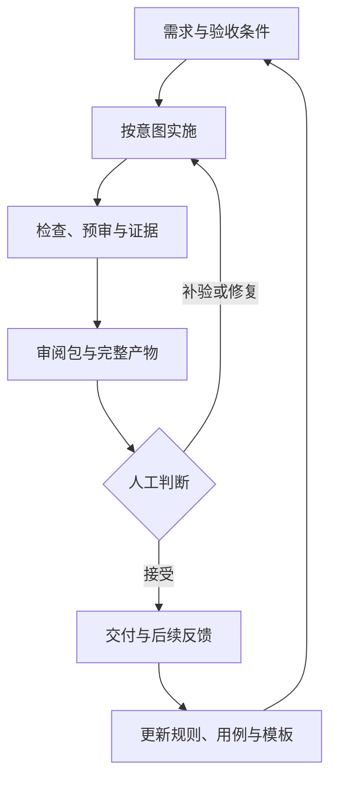

# Agent Review 方法体系：用更少的注意力完成可靠验收

**目标：减少人为了形成可靠判断而付出的时间，让关键问题更容易被发现，让每次验收可以追溯。**

适用对象包括代码、技术文档、方案设计和分析报告。共同入口是“本次需要判断什么，以及有哪些证据”，具体检查方法随产物和风险变化。

本页是**本仓库的设计建议**，定义贯穿信息呈现、内容结构、交互体验、自动预审、验证机制和工作流的方法架构。安装与使用见 [review-workflow.md](review-workflow.md)，模板复用 [Review Package](../claude/skills/review-package/templates.md)，不再维护第二套规则或 Skill。

**验证边界：** 引用的产品能力已按官方文档核对，核对日期为 **2026-11-19**；本页没有执行用户实际客户端、业务代码或效果实验。示例均为假设场景，不代表已经完成测试，也不代表已取得提效结果。

## 1. 先定义要优化的结果

一份输出读起来顺畅，仍可能难以验收：读者理解了作者的解释，却不知道需求是否满足、是否遗漏风险、证据是否对应当前版本。因此，最终指标应覆盖形成判断的全过程。

建议观察：

> 每个被接受产物所消耗的人工有效审阅时间，包括理解、找证据、检查、追问和返工后的再次审阅。

接受前若经历多轮审阅，各轮时间都计入；放弃、退回和受阻的任务另外记录，避免只计算成功任务。等待 Agent 或构建的时间单列，不能因为人暂时离开，就把额外等待算成效率收益。

| 目标 | 看什么 | 必须同时观察的护栏 |
| --- | --- | --- |
| 阅读更快 | 找到关键变化和风险所用时间 | 是否遗漏重要上下文 |
| 需要读得更少 | 重复阅读、无关日志和手动搜索减少 | 完整范围是否仍可追溯 |
| 判断更准确 | 结论能否被证据支持、问题是否被正确定位 | 交付后遗漏、误报与错误接受 |
| 验收更高效 | 从开始审阅到接受、退回或补验的主动时间 | 返工、总等待、Agent 费用 |

不要把更少评论、更多“通过”、更短报告或更高的机器评分当作单独目标。它们可能反映流程改善，也可能反映问题没有被看见。

## 2. 六个维度如何组成一个闭环

| 维度 | 要解决的问题 | 推荐机制 | 失效信号 |
| --- | --- | --- | --- |
| 信息呈现 | 扫描困难、重点淹没 | 状态醒目、对照展示、适量高亮 | 页面漂亮但找不到失败项 |
| 内容结构 | 需要自行还原背景与意图 | 结论先行，按行为或论点组织 | 摘要只复述修改过哪些文件 |
| 交互体验 | 搜索、切换、重复阅读多 | 证据直达、保留阅读位置、增量审阅 | 每轮都从头读全量报告 |
| 自动预审 | 人在检查可重复的问题 | 确定性检查、专项预审、发现去重 | 泛泛意见增多，实质发现很少 |
| 验证机制 | 不知道结论是否可靠 | 验收条件与证据映射、版本绑定 | “测试通过”没有覆盖范围 |
| 工作流 | 质量检查太晚、反馈丢失 | 生成前定目标，生成后举证，反馈沉淀 | 相同问题反复出现 |



这六个维度应共同减少人工负担。呈现和交互负责把注意力带到正确位置；验证与预审负责让那里有可判断的内容；工作流负责避免每个任务重新开始。

## 3. 从生成之前降低审阅成本

### 3.1 把验收条件写成可观察结果

任务开始时，从需求、项目规则和已有讨论中提取四类信息：目标行为、保持不变的约束、重要边界、成功证据。信息已经明确时直接沿用；只有会改变实现方向或验收结论的歧义才需要澄清。

例如，“修好状态错乱”可以具体化为：“晚到的旧请求不能覆盖较新请求对应的页面状态；失败后的恢复行为保持原约定；需要能触发旧问题的检查。”这不要求提前规定全部实现细节，却给生成和审阅共享的判断依据。

文档也一样。“写一份调研”应说明它要支持哪个决定、需要比较哪些约束、哪些事实需要来源，以及哪些未知会改变建议。没有用途的完整性，很容易扩张成篇幅。

### 3.2 按业务意图切块

一个审阅单元尽量对应一个可解释、可验证的行为变化，并携带相关测试或证据。把必要实现拆得过碎，也会迫使读者跨多个提交还原含义。Google 的建议以自包含变化为中心，并强调相关测试和理解所需上下文，而非统一行数阈值。[S1]

建议将功能变化、必要重构、机械格式化分别说明。能独立交付时再拆成独立变更；存在依赖时明确顺序，避免制造无法单独理解或运行的中间状态。

对长报告，以“一个主张及其证据”组织章节；对设计，以“一个重要取舍及其后果”组织。文件清单负责完整性，意图分组负责理解。

## 4. 按风险分配注意力与验证成本

风险至少综合三个因素：**出错后果、实现与领域的不确定性、可获得证据的充分程度**。改动行数只能帮助估计阅读量，不能决定风险等级。

| 等级 | 典型条件 | 推荐审阅与验证 |
| --- | --- | --- |
| 轻量 | 局部、熟悉、可逆，影响边界明确 | 简短摘要、完整变化入口、相关快速检查 |
| 常规 | 改变行为，涉及多个模块或需要权衡 | 按意图导览、验收映射、边界检查、必要预审 |
| 深入 | 失败后果大，涉及并发、数据、权限、硬件，或缺少领域知识 | 更完整的影响分析、专门证据、领域校准与必要环境验收 |

这是本仓库建议的工作分级，不是自动风险评分标准。一个几十行的生命周期改动可能需要深入审阅；大批可机械验证的文案修改可以采用不同方法。

风险分级决定阅读顺序、辅助说明和额外验证的强度，**不替代项目要求的完整代码审查**。抽样可以检查批量产物或非重点区域是否存在系统性遗漏，但不能成为跳过关键代码、强制门禁和业务验收的理由。

遇到未知领域，可让 Agent 寻找仓库内相似实现、列出差异并提供官方依据。它能减少获取背景的成本；领域知识不足时，仍可能需要熟悉该领域的人校准关键判断。

## 5. 最小 Review Package：交付可判断的内容

审阅包应是产物的阅读入口，不是第二份项目报告。沿用既有 [模板](../claude/skills/review-package/templates.md)，按任务缩放以下信息。

| 信息 | 必须回答的问题 |
| --- | --- |
| 意图 | 要解决什么，哪些边界需要保持？ |
| 变化 | 用户行为、系统行为或核心结论发生了什么变化？ |
| 证据 | 哪些检查、数据、来源支持当前结论？ |
| 风险 | 哪些条件尚不明确，哪些地方没有覆盖？ |
| 待决策 | 现在具体需要人接受、选择、退回或补验什么？ |
| 完整入口 | 从哪里查看完整 Diff、全文、清单和原始证据？ |
| 版本 | 这些内容和证据对应哪个基线、快照及运行环境？ |

轻量任务可在一屏内合并这些信息；常规任务再增加行为表和证据映射；复杂任务才需要独立章节或交互视图。没有需要人决定的事项，就明确说明，不为凑模板制造问题。

首屏优先显示建议状态、关键变化、失败与未知、待判断问题。详细解释按需展开，完整范围仍可访问。建议状态只能是有依据的建议，不能代替责任人或项目流程的接受决定。

需要防止两种偏差：作者只展示自己验证成功的部分；读者把流畅说明当成正确性的证据。因此，完整变更清单、未覆盖项和原始产物入口不能被摘要取代。

变化清单优先由版本管理或文件比较工具直接生成，再由 Agent 解释和分组。核对清单中是否有未被摘要覆盖的内容，能避免让摘要同时承担“选择重点”和“证明没有遗漏”两项职责。

## 6. 建立“结论—产物—检查—来源”证据链

建议为重要验收项建立轻量映射，不要求每一行代码都配一段说明。

| 验收项或结论 | 产物位置 | 检查或来源 | 状态与边界 |
| --- | --- | --- | --- |
| 行为满足要求 | 实现位置、相关调用点 | 针对性用例、复现记录 | 覆盖了什么条件 |
| 没有改变既有约定 | 接口、行为对照 | 回归、差分检查 | 未覆盖什么环境 |
| 数字与趋势成立 | 表格、计算过程 | 数据快照、脚本、指标定义 | 样本与时间范围 |
| 方案适合当前约束 | 决策段落 | 约束、备选比较、事实来源 | 假设与取舍 |

证据状态统一使用清楚的词：

| 状态 | 含义 |
| --- | --- |
| 通过 | 已执行相应检查，并满足明确条件 |
| 失败 | 已执行，结果不满足条件 |
| 未运行 | 本轮没有执行，不能推断结果 |
| 受阻 | 已知缺少依赖、环境、权限或数据，无法完成 |
| 不适用 | 检查不适用于本任务，并说明依据 |
| 失效 | 证据对应旧版本或旧假设，需要重新判断 |

“通过”还应包含范围：命令或检查方法、版本、环境、关键结果和日志入口。不能将编译通过表述为业务正确，也不能将静态页面截图视为完整交互验收。

绑定版本时，代码至少记录比较基线与被审阅快照。工作区未提交内容可能在 HEAD 不变时变化，因此 commit 号不是唯一依据；必要时记录差异或相关内容的快照。文档记录版本或内容标识，报告还记录数据口径和数据版本。

测试是否有用也需要判断。若一个 Bugfix 的用例在旧问题存在时仍通过，它可能没有提供所需区分力。Google 的审查指南明确要求关注测试是否能在代码损坏时失败，以及测试本身是否合理。[S2]

## 7. 自动预审：把发现变成可核实的问题

### 7.1 三类手段承担不同职责

| 手段 | 适合承担 | 不能据此保证 |
| --- | --- | --- |
| 确定性检查 | 格式、类型、编译、明确断言、数据复算 | 需求解释和所有真实行为都正确 |
| Agent 预审 | 发现边界遗漏、实现不一致、可维护性问题 | 每条发现为真，或未报告区域无问题 |
| 人工判断 | 业务意图、取舍、领域约束与接受剩余风险 | 只凭直觉看见所有缺陷 |

Anthropic 的评估指导区分基于代码、模型和人工的评分方法，并讨论其适用边界；可据此组合检查，但不能把单一分数当作完整质量结论。[S3]

检查按风险和成本排序：先复用已有快速检查，再补能回答具体疑问的验证。相机等依赖硬件的功能，仍可能需要设备级证据。Android 官方测试策略建议使用不同范围的测试，并特别提醒相机、媒体等场景可能改变常见测试分布。[S4]

### 7.2 让预审具有独立检查的条件

向预审者提供任务目标、验收条件、完整变化、必要上下文和证据；可让它先检查原始产物，再对照作者摘要，减少只沿作者解释寻找支持的倾向。

独立上下文能减少直接继承实现过程的影响，跨模型可能提供不同视角；二者都不保证错误独立。多个 Agent 同意也不构成正确性的证明。更有价值的是提出能检查的不同假设，并用代码、用例、来源或领域知识判定。

复用现有 [review-auditor](../claude/agents/review-auditor.md) 时，保留其读取与搜索边界。需要运行检查，由具备相应授权的主流程执行并提供结果，不把“只读审阅”悄悄扩成自动修复。工具权限与自然语言指令也应分别核对。[review-workflow.md](review-workflow.md) 已说明本仓库的职责划分。

### 7.3 先判真、去重，再交给人

每个发现至少包含：位置、触发条件、实际影响、依据和建议下一步。同根因的重复发现合并；缺少证据的疑点标为待核实；纯偏好与功能缺陷分开。

严重程度用于排序，不意味着只接收最严重的问题。中等风险的回归、稳定复现的小缺陷，以及关键验收条件未覆盖，仍可能影响是否交付。也不要强迫预审必须找出固定数量的问题，这会增加无效意见。

当前 Claude Code 官方文档提供 `/code-review` 本地入口；自动修复和发表评论是另外的行为。是否使用该入口，仍需匹配当前客户端和权限，不把厂商文档支持等同本机验证完成。[S5]

已有 Codex 工作流可以复用交互式 `/review`；脚本化入口为 `codex review`，可选择 `--uncommitted`、`--base <分支>` 或 `--commit <SHA>` 中的一种范围。每次明确审阅目标，避免把三种范围混在同一条命令里。原生预审提供发现，验收包仍需补充需求、证据状态与完整范围。[S11][S12]

## 8. 不同产物采用不同检查表

| 产物 | 优先核对 | 合适的证据 | 必须由人关注的判断 |
| --- | --- | --- | --- |
| Bugfix | 原因、触发条件、失败与恢复分支 | 可复现问题、针对性检查、相关回归 | 是否修到真实原因，是否引入不必要复杂度 |
| 需求代码 | 行为、接口、边界、影响范围 | 验收映射、调用上下文、测试或演示 | 实现是否符合需求和项目约束 |
| 技术文档 | 事实、术语、示例、适用版本 | 来源、可运行示例、版本差异 | 读者是否据此正确行动 |
| 方案设计 | 约束、备选、代价、失败方式 | 决策记录、接口约束、估算依据 | 取舍是否适合当前团队和目标 |
| 分析报告 | 口径、数据、计算、样本、结论 | 原始数据入口、复算、来源与时间窗 | 证据是否足以支持行动建议 |

文档检查不止是错别字与结构，方案检查不止是“有优缺点”，报告检查不止是“有引用”。要核实来源是否支持附近的论点、估算是否说明假设、结论是否超出了证据范围。

GOV.UK AQuA Book 区分两类保证：分析是否按规格正确完成，以及分析是否适合它要支持的用途；同时要求质量保证与风险、复杂度相匹配，并管理不确定性。[S6] 这适合用于非代码验收：一份计算无误的报告，仍可能回答了错误的问题。

## 9. 选择呈现形式，并让第二轮审阅更轻

### 9.1 一个内容源，多种阅读入口

| 载体 | 推荐用途 | 应避免 |
| --- | --- | --- |
| 终端 | 状态、短摘要、当前问题、Diff 入口 | 大段日志和复杂宽表挤占注意力 |
| Markdown | 可版本管理的说明、检查表、来源与记录 | 靠固定长模板强行展开所有任务 |
| HTML | 复杂比较、图表、长内容导航、证据联动 | 为每个小任务生成独立应用 |

沿用仓库已选择的内置 `/diff` 与 Difftastic。Difftastic 按语法结构比较文件，可帮助区分结构与格式变化；它不能证明程序行为等价，原始变化入口仍需保留。[S7] 本页不扩展仓库已经评估并放弃的工具组合。

使用 `/diff` 时注意范围：官方文档说明逐轮视图来自 Claude 的文件编辑，shell 造成的变化只显示在 `Current` 工作区视图；面板默认还会跳过测试和生成文件，需要展开相应计数查看。[S10] 因此逐轮视图适合导航和理解修复过程，最终仍应核对比较基线、完整变化及相关新增文件，不能把默认可见列表当成完整交付范围。

具体面板能力依客户端版本、渲染模式与终端宽度而定，试用时核对本机支持情况。

输出风格可以固定语气和组织方式，但不能强制证据存在。Claude Code 官方文档也区分输出指令与需要稳定执行的工具机制。[S8] 内容规则、检查执行和视觉样式应各负其责。

Markdown 或结构化数据保持为可维护源；HTML 按需生成，避免同一结论维护两套版本。界面先让风险可见，再优化色彩、排版和动画。

### 9.2 渐进披露，不增加寻找成本

默认展示结论、风险和待决策；相关解释、Diff、数据和来源尽量一跳可达。支持全文搜索、展示全部、前后对照，长内容保留定位。不要把相互依赖的材料切成很多需要来回跳转的页面。

NN/g 对渐进披露的要求是选对首屏信息，并提供清晰的进一步查看入口；过多嵌套层级会增加使用困难。[S9] 因此可以有不同信息粒度，但不必做成多层折叠树。

### 9.3 增量审阅绑定上次版本

第二轮优先给出“上次审阅快照 → 当前快照”的差异、每条意见的处理结果、新风险和新证据，同时保留总体变化入口。

已审阅内容可以保留状态，但依赖变化会使旧判断失效。例如公共函数变化可能影响未修改的调用方；数据口径变化可能使未改字句的结论需要重审。不能只根据一行有没有变化来保留“已确认”。

意见状态可采用：已修复、已解释并保留、待补验、仍待决策。是否关闭意见应依据处理结果，避免以“Agent 已回复”代替问题解决。

## 10. 本地与云端如何衔接

适合终端作为主入口的一种工作流是：**本地规划 → 云端实施 → 本地只读 Review → 云端修复 → 验收**。这是可选职责分配，不要求所有任务迁移到云端。

| 阶段 | 交接内容 | 人主要做什么 |
| --- | --- | --- |
| 本地规划 | 目标、约束、基线、验收条件 | 判断有影响的歧义与取舍 |
| 云端实施 | 产物快照、变化清单、检查结果 | 按需查看关键进展 |
| 本地只读 Review | 同一快照、证据、风险、预审发现 | 核对重点，形成具体反馈 |
| 云端修复 | 意见编号、必要上下文、期望结果 | 避免逐段搬运和重复解释 |
| 验收 | 增量、意见闭环、失效证据处理 | 接受、退回或要求补验 |

每次交接明确任务标识和版本。审阅者与实施者看到的如果不是同一份内容，讨论质量再高也可能失去作用。反馈应落在共享的任务或变更记录中，由 Agent 获取；只有必要材料才复制到另一个环境。

本地只读是审阅阶段的职责约束。任何修复、发表评论、合并或发布，仍按已有授权和项目流程执行。并行实施时采用清楚的分支或隔离工作区，避免审阅中的产物被无意改写。

业务原始证据留在对应受控环境。本公开仓库沉淀通用规则、模板和脱敏经验，具体边界见 [产物约定](asset-conventions.md)。

## 11. 两个假设案例

以下仅说明如何组织审阅，**没有对应真实任务、实际日志或已通过测试**。

### 11.1 跨端相机：旧回调覆盖新状态

假设快速切换摄像头后，旧请求晚到的结果覆盖了当前页面。Android 与 iOS 都需要修复，审阅者熟悉其中一端。

推荐按判断组织材料：

| 要判断什么 | 要求提供的材料 |
| --- | --- |
| 期望行为是否明确 | 请求先后与回调到达顺序，以及应更新或应丢弃的条件 |
| 改动是否处理真实原因 | 关键路径前后对照、请求身份或有效性判断的依据 |
| 是否考虑边界 | 连续切换、离开页面、失败返回等相关场景 |
| 两端是否满足同一需求 | 相同的用户行为验收表，各端分别记录证据状态 |
| 陌生端是否符合项目惯例 | 现有类似实现、差异解释、需要领域校准的地方 |

两端共享行为标准，实现结构可以不同。事件顺序示意帮助理解并发关系，针对性检查帮助判断逻辑，设备证据帮助判断硬件环境中的实际表现。三者回答不同问题，不能相互替代。

若模拟环境验证了请求身份判断，但没有设备条件，合理交付应明确“逻辑检查已有证据，设备场景受阻或未运行”，而不是将整个功能标成通过。

### 11.2 报告：交付率提高是否成立

假设报告需要解释某类 Agent 工作流的交付率与耗时，并推荐下一步优化。先写指标字典，再审图表和建议。

| 指标 | 需要定义的内容 |
| --- | --- |
| 任务覆盖率 | 哪些任务进入分母，何种贡献计入分子，按什么时间窗统计 |
| 变更请求生成率 | 以任务还是尝试为单位，失败重试是否重复计数 |
| 接受或合入率 | 什么状态算完成，观察期结束时未完成任务如何处理 |
| 耗时 | 起止点、等待与执行、分布、异常值和任务类型 |

“至少发生一次贡献”“生成变更请求”“最终被接受”是不同事件，不能共用一个未解释的成功率。若只观察已完成任务，还可能漏掉最慢或失败的任务。

结论最好连接到数据入口、计算方法和限制条件。优化前后任务难度不同时，先说明可比性；看到指标改善，并不足以单独证明改善由某项措施造成。

人应重点判断：指标是否回答真实管理问题，证据是否足以支撑优先级，缺失数据是否会改变行动。格式、复算和一致性由 Agent 尽量提前处理。

## 12. 两周低负担实验

先沿用 [一周试用](review-pilot.md) 的记录口径；需要更充分观察时延长为两周，不另造一套指标。

建议选取约 8～12 个真实任务，标记产物类型、风险、规模与领域熟悉度。这个数量用于发现摩擦，不用于宣称统计显著性或固定提效比例。

| 时间 | 做什么 |
| --- | --- |
| 第 1～2 天 | 记录现有方式的卡点，确认最小审阅包和证据状态 |
| 第 3～7 天 | 在相近任务中交替使用原方式与新方式，先只改变交付结构 |
| 第 8～12 天 | 对需要的任务增加专项预审或增量展示，记录额外成本 |
| 第 13～14 天 | 对照人工时间、质量与成本，删去没有帮助的环节 |

每次记录控制在一分钟以内：人工主动时间、找证据与澄清次数、首次决定、等待和 Agent 成本、后续遗漏与返工、最有用和最多余的部分。成本取不到就写未知，不用估计值伪装实测。

需要避免的比较错误：

- **熟悉效应：** 不让同一个人审同一产物两次，再把第二次变快归功于工具。
- **任务差异：** 简单文案与并发 Bugfix 分开看，不用混合均值直接比较。
- **幸存者偏差：** 退回、失败、放弃和仍在等待的任务也进入记录。
- **同时改变太多因素：** 不把字体、模型、模板、验证方式一起替换后归因给其中一个。
- **质量观察不足：** 两周未发现遗漏不代表长期可靠，应保留后续问题回填入口。

试验继续执行原有必要审查和门禁。是否采用新方法，应看它减少了哪些具体负担、是否增加遗漏与总成本，而非追求一条好看的效率曲线。

## 13. 优先落地与停止条件

建议依次推进：

1. **固定交付问题。** 复用 Review First，让每次交付说明变化、证据、风险和待判断事项。
2. **补齐可追溯证据。** 使用 Review Package，把结论连到真实产物与当前版本。
3. **减少第二轮重复阅读。** 记录审阅快照和意见处理，优先展示增量。
4. **按风险增加预审。** 聚焦实际疑点，判真、去重，再交给人。
5. **针对高频摩擦改善界面。** 优先完善现有终端、Diff 与按需 HTML；有持续需求再建设独立工具。

以下信号意味着应缩减或停止某一环节：

- 审阅包比简单任务本身更难读：缩为终端摘要和真实变化入口。
- 预审等待与费用明显增加，却很少产生有效发现：降低触发频率，收窄检查范围。
- HTML 没有减少寻找和比较，反而增加维护：回到 Markdown 内容源与直接链接。
- 结论仍无法判断：补充缺失证据或领域校准，不靠继续润色摘要解决。
- 证据已经足够满足验收与必要门禁：停止无目的扩大检查，推进交付。

每次发现真正有价值的遗漏，只沉淀能跨任务复用的规则、用例或模板改进。一次性特殊情况保留在任务记录中，避免常驻规则无限增长。

可复制的轻量请求：

```text
请按仓库现有 review-package 规范审阅当前产物。
基线/范围：<分支、版本或文档范围>；目标：<本次要验收的行为或结论>。
先给关键变化、风险、证据状态和需要我判断的问题；保留完整产物入口。
按风险选择必要检查，只报告可定位、有依据的发现；不要自动修复或发表评论。
若有上一轮审阅，优先展示增量、意见处理和已失效的证据。
没有执行的检查请明确标记；不要把说明或模型共识当成验证结果。
```

## 14. 现有资产与来源

### 仓库内的唯一入口

| 需要做什么 | 复用资产 |
| --- | --- |
| 了解安装与职责边界 | [review-workflow.md](review-workflow.md) |
| 固定长期交付约定 | [review-first.md](../claude/rules/review-first.md) |
| 按需生成审阅包 | [Review Package Skill](../claude/skills/review-package/SKILL.md) |
| 选择代码、文档和分析模板 | [templates.md](../claude/skills/review-package/templates.md) |
| 请求受限工具的预审 | [review-auditor.md](../claude/agents/review-auditor.md) |
| 使用已有专项指令 | [prompts/review-workflow.md](../prompts/review-workflow.md) |
| 记录效果与客户端验收 | [review-pilot.md](review-pilot.md) |
| 查终端与 HTML 调研 | [research-report.md](research-report.md) |
| 确认公开内容和维护边界 | [asset-conventions.md](asset-conventions.md) |

### 外部依据

以下来源支持相应工程原则或产品机制；本页的组合方法、分级、顺序与试验安排均为本仓库建议。软件能力仍需结合实际版本、组织策略和环境验证。

| 编号 | 来源 | 支持内容 | 核对日期 |
| --- | --- | --- | --- |
| S1 | [Google Engineering Practices：Small CLs][S1] | 自包含变化、相关测试与理解上下文 | 2026-11-19 |
| S2 | [Google：What to look for in a code review][S2] | 设计、功能、复杂度与测试有效性 | 2026-11-19 |
| S3 | [Anthropic：Demystifying evals for AI agents][S3] | 不同评估方法与能力边界 | 2026-11-19 |
| S4 | [Android Developers：Testing strategies][S4] | 测试范围、成本与硬件场景差异 | 2026-11-19 |
| S5 | [Claude Code：Review locally with /code-review][S5] | 本地预审入口及可选修复、评论行为 | 2026-11-19 |
| S6 | [GOV.UK：The AQuA Book][S6] | 分析的正确性、适用性、比例原则与不确定性 | 2026-11-19 |
| S7 | [Difftastic 官方网站][S7] | 按语法结构比较的 Diff 能力 | 2026-11-19 |
| S8 | [Claude Code：Output styles][S8] | 输出指令与执行机制的区别 | 2026-11-19 |
| S9 | [NN/g：Progressive Disclosure][S9] | 信息优先级、清晰入口与层级限制 | 2026-11-19 |
| S10 | [Claude Code：Interactive mode][S10] | 逐轮 Diff 与工作区视图的范围、隐藏文件类别 | 2026-11-19 |
| S11 | [OpenAI：Code review][S11]、[Developer commands][S12] | Codex 本地预审与非交互命令的范围选择 | 2026-11-19 |

[S1]: https://google.github.io/eng-practices/review/developer/small-cls.html
[S2]: https://google.github.io/eng-practices/review/reviewer/looking-for.html
[S3]: https://www.anthropic.com/research/demystifying-evals-for-ai-agents
[S4]: https://developer.android.com/training/testing/fundamentals/strategies
[S5]: https://code.claude.com/docs/en/code-review-local
[S6]: https://www.gov.uk/guidance/the-aqua-book
[S7]: https://difftastic.wilfred.me.uk/
[S8]: https://code.claude.com/docs/en/output-styles
[S9]: https://www.nngroup.com/articles/progressive-disclosure/
[S10]: https://code.claude.com/docs/en/interactive-mode
[S11]: https://learn.chatgpt.com/docs/code-review
[S12]: https://learn.chatgpt.com/docs/developer-commands
